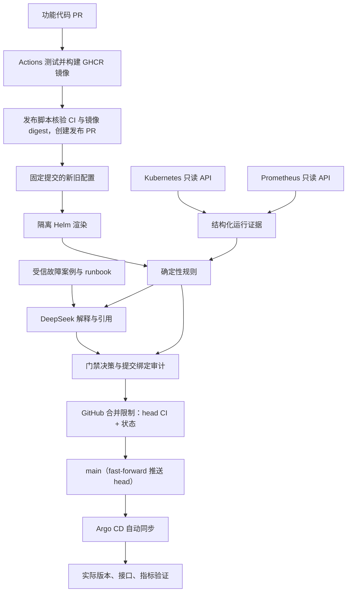

# 项目二：发布变更风险守护 Agent

## 1. 项目解决什么问题

项目一能构建镜像、发布到 GHCR，再由 Argo CD 同步 Git 中的配置。项目二在配置进入发布分支前判断风险，并把判断落实到 GitHub 合并限制。目标是：不合规发布无法进入 main，正常发布具备可追溯证据，并在部署后验证实际结果。

Go 0.3.2 已完成真实门禁、发布、回退和最终环境验收。危险 PR8 被阻断；PR9 与回退 PR10 均经新评估、精确审批、可信 CI 和受限 fast-forward 合入，发布与回退各通过 6/6 postdeploy。最终两节点 Ready、ArgoCD Synced / Healthy、业务恢复旧镜像，测试流量已清理。

详见 [Go 最终验收](go-acceptance-final.md)；历史版本记录保留各自的时间和范围。

Agent 只读集群，不是 Kubernetes 准入控制器。集群管理员仍有直接操作 Kubernetes 的权限；仓库管理员能够修改规则或部署凭据。这些管理员属于信任边界。GitHub 的 DeployKey bypass 是仓库级能力，不能按单 key 限制；实际只保留一把写部署密钥，这是必须审计的信任边界。

## 2. 数据与控制流程

## 3. 工具各做什么

| 工具 | 责任 | 判断依据 |
| --- | --- | --- |
| Go 单二进制 | 配置差异、证据采集、规则、检索、模型调用、GitHub 状态与审计、token helper、postdeploy | 固定提交、字段路径、查询与时间戳 |
| Ansible | 独立用户、可信二进制、RBAC、kubeconfig、systemd、代理与凭据权限 | 可重复执行、服务状态、只读权限实测 |
| Shell | 健康检查、本地验收、场景矩阵、RBAC、网络预检 | 非零退出码与原始输出 |
| GitHub Actions | 项目一的测试和镜像构建；项目二自身回归测试 | 绑定 PR head 的 check run/结论，不把 synthetic merge 的空 check 当成功 |
| GitHub 保护规则 | 限制 main 更新与必要检查 | 两组 ruleset：DeployKey 只能仓库级 bypass；required checks 无 bypass |
| Argo CD | 部署合并后配置 | Git revision、Synced/Healthy |
| Prometheus | 提供错误率、延迟、内存与告警 | 原始响应、查询窗口、抓取新鲜度 |
| DeepSeek | 解释已有证据、检索相关故障经验、提出额外风险供人工判断 | 固定结构、可信引用、独立记录 |

Agent 在 master 运行，主动轮询 GitHub，无公网监听端口。worker 继续运行项目一工作负载。

## 4. 四种决策

| 决策 | 含义 | 合并处理 |
| --- | --- | --- |
| PASS | 必需证据有效、硬规则通过，未发现需人工处理的风险 | 在报告绑定与有效期检查通过后允许进入发布流程 |
| REVIEW | 资源/容量/已有异常/AI 新风险等需要人工判断 | 等待与本次评估绑定的明确审批 |
| BLOCK | 副本为零、探针破坏、故障开关、镜像或安全策略违规等 | 禁止放行，人工审批不能覆盖硬规则 |
| ERROR | 采集失败、证据过期、渲染错误、模型超时/结构不合法等 | 禁止放行，修复评估能力后重试 |

同一评估可同时存在多类发现，最终等级使用 `BLOCK > ERROR > REVIEW > PASS`，所以 AI 出错不能把硬阻断降级。`charts/demo` 不在操作员 `approved_chart_digest` 白名单、`.github/workflows/` 与 base 不一致、报告策略绑定不匹配，均是不可审批的硬阻断。

## 5. AI 实际增加什么

规则负责可复现的事实判断。AI 把字段变更、运行证据和项目一的真实故障案例联系起来，生成带引用的解释与处置建议。新增风险只触发 REVIEW。模型没有命令执行工具，不能直接操作集群，也不能修改硬规则结论。

**审批不是 AI 动作。** REVIEW 的精确 `/guard approve` 由用户授权的 dsh 操作员以
owner 身份发出；在线 DeepSeek 没有 GitHub 凭据、审批身份、合并或回滚能力，不能
自批。0.3.1 的 PR9 就是这种人工代理审批：评论作者是 owner `hey-mmm`，AI 只提供了
分析。该次 AI 还把被脱敏、但实际未改动的 env 值当成“可能带入演练故障开关”的新风险；
独立 reviewer 用 base/head 精确 blob 证明 `APP_ENV`、`DEMO_ERROR_RATE`、
`DEMO_LATENCY_MS`、`DEMO_STARTUP_FAIL` 均未变化，因此这是 AI 误报。保留的真实
REVIEW 限制是未预留 requests、`KubeCPUOvercommit` 和零初始流量。

可信知识库保存源文档、来源 URL、原文片段和摘要校验。PR 中的 runbook 不会成为评估程序或知识库。模型输出引用必须匹配本次检索到的案例，格式错误、未知引用与超时均进入明确失败状态。

## 6. 必须诚实说明的限制

- 单 worker 不提供节点容灾，增加副本不代表高可用。
- 内存阈值使用近期观测并保留余量，不能证明将来一定不会 OOM。
- CPU/内存 requests 是调度依据，仍受亲和性、污点、磁盘、Pod 数量等限制。
- 零流量时无法证明错误率或延迟正常，不能用空结果代替零错误。
- 镜像 `/version` 是应用元数据，必须结合实际镜像 digest 检查；发布后验证的 `--expected-sha`（Argo/GitOps revision）与 `--expected-app-sha`（镜像源提交）通常不同，必须同时提供。
- `deepseek-chat` 是供应商模型别名，记录请求/返回模型信息不等于获得可永久固定的模型权重版本。
- GitHub 成功状态本身没有项目所需的分钟级自动过期功能；最终合并路径必须额外检查当前报告与证据，不能只相信绿色状态。
- GitHub Actions 的 `pull_request` check 绑定 PR head；synthetic merge 只用于证明“快进 head 不改变树”，不能拿它的空 check 当 CI。
- DeployKey bypass 是仓库级，平台不能限制到单 key；只能靠“仓库只有一把写 key + 审计”约束。
- `charts/demo` 模板变更必须由操作员另行更新可信 pin（当前真实 Git blob digest 为 `194baf90afd746299e256dc0bf144a12bc6f6325bacf77b40ff01e50b0c3e05d`，旧 `0b2b...` 参考值不可用）；guard 不会自动信任新模板。发布 PR 的正常配置入口是 `gitops/demo/values.yaml`，不是 chart 自带的 `values.yaml` 默认值。
- 发布后失败只记录结果并给出 Git revert PR 建议，不让模型直接回滚；main 是单父 head，回退用普通 `git revert`，不加 `-m 1`。
- 正常发布的真实结果通常是 **REVIEW + 人工精确批准**，不是自动 PASS；单 worker 资源余量、低流量、当前错误/延迟都可能要求人工判断。
- 单 worker 和本地 PVC 没有节点/磁盘容灾；Prometheus 指标是最近 5 分钟聚合，部署后 60 秒等待不是新版本专属桶；99.9% SLO 需要完整七天数据，不能用一次发布或合成场景证明。
- Go 0.3.2 已完成真实门禁、发布、回退和最终环境验收。危险 PR8 被阻断；PR9 与回退 PR10 均经新评估、精确审批、可信 CI 和受限 fast-forward 合入，发布与回退各通过 6/6 postdeploy。最终两节点 Ready、ArgoCD Synced / Healthy、业务恢复旧镜像，测试流量已清理。 见 [最终验收](go-acceptance-final.md)。
- 合并后 daemon 会撤销 closed/merged PR 的历史 guard 状态；main/旧 head 出现 guard error/pending 可能只是撤销，不是 postdeploy 失败；门禁证明看 merge 记录和当时报告/审批/CI，不要强留永久绿。

实际完成项、未通过项与证据索引见 [验收报告](acceptance.md)。
